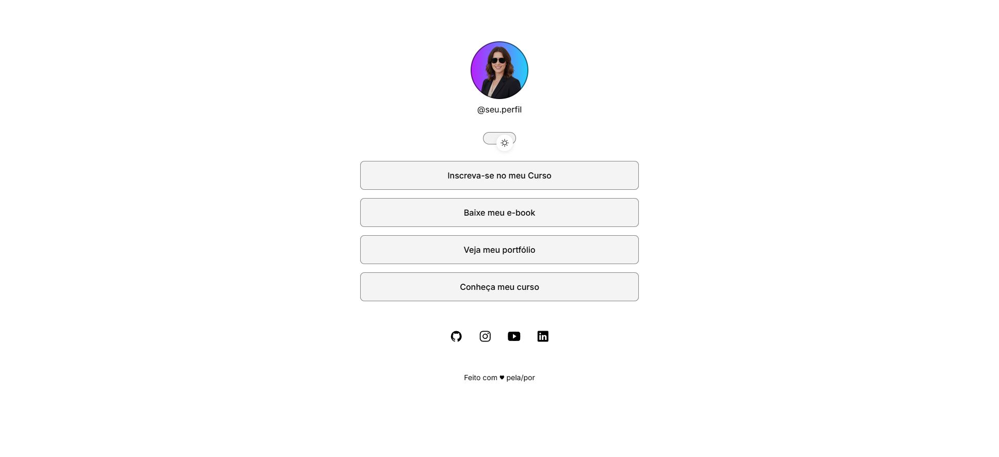
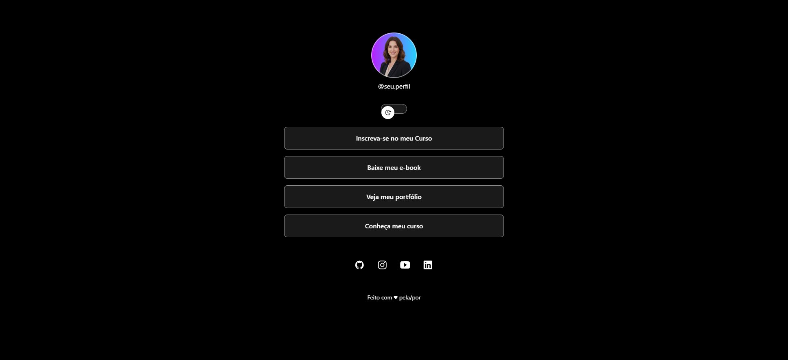

# DevLinks

Página de links pessoal feita com **React + Vite**, reproduzindo fielmente o design do Figma nos modos claro e escuro, em desktop e mobile.

Autor: **Gleisson**. GitHub: [GleissonPDias](https://github.com/GleissonPDias)

## Funcionalidades

- Avatar, nome de usuário, quatro botões de links e ícones sociais.
- Alternância entre modo claro e escuro com `useState`.
- Tema salvo no `localStorage`, mantido após recarregar a página.
- Links externos abrem em nova aba com `target="_blank"` e `rel="noopener noreferrer"`.
- Layout responsivo (mobile-first), sem overflow horizontal.

## Tecnologias

- React 19 + Vite
- CSS puro (variáveis para os temas claro e escuro)
- Fonte Inter (Google Fonts)

## Estrutura

```text
src/
├── components/
│   ├── Profile.jsx       # avatar e @usuário
│   ├── LinkButton.jsx    # botão de link
│   ├── ThemeToggle.jsx   # switch claro/escuro
│   └── SocialLinks.jsx   # ícones sociais
├── data/
│   └── links.js          # links, redes sociais e nome de usuário (via Props)
├── assets/               # imagens e ícones do Figma
├── App.jsx               # estado do tema e composição da página
├── index.css             # tokens do Style Guide e estilos
└── main.jsx
```

## Como rodar

```bash
npm install
npm run dev
```

Abra `http://localhost:5173/`.

Para gerar a versão de produção:

```bash
npm run build
```

## Personalização

Edite `src/data/links.js` para trocar os links, o nome de usuário e as redes sociais. Os componentes recebem tudo por Props.

## Prints

| Desktop — Claro | Desktop — Escuro |
|---|---|
|  |  |

## Documentação

- [`AGENTS.md`](AGENTS.md): instruções para o agente de IA usado no projeto.
- [`docs/figma-reference.md`](docs/figma-reference.md): medidas, cores e tipografia extraídas do Figma.
- [`docs/checklist.md`](docs/checklist.md): checklist de validação.
